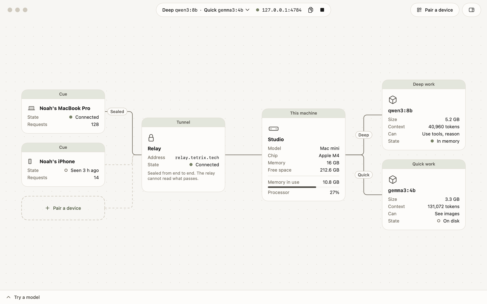

# Tetrix Host

Run the models behind your Tetrix apps on a machine you own.

Tetrix Host is a program for your own Mac, PC, or server. Apps such as Cue pair with it and send their model requests to it instead of to models Tetrix rents. The requests travel through a relay, sealed from end to end, so the host needs no static address, no forwarded port, and no VPN, and the relay cannot read what passes.



## What is in this repository

| Part | What it is | Where |
|------|------------|-------|
| `tetrix-host` | The host and its command line, in Go. One binary for macOS, Linux, and Windows | `cmd/`, `internal/` |
| The relay | The server that joins a host and its paired devices. The same binary, `tetrix-host relay serve`, or a Cloudflare Worker | `internal/relay/`, `deploy/cloudflare/` |
| `TetrixHostKit` | The Swift package an app adds to pair with a host and use it | `Package.swift`, `Sources/`, `Tests/` |
| Tetrix Host for Mac | A window onto a running host: a board of the machine, its models, the tunnel, and paired devices | `TetrixHost.xcodeproj`, `App/` |

## Status

This is version 0.1, built on 2026-11-11. It works end to end and has not shipped.

What works: the host, the relay, pairing, the sealed tunnel, roles, the CLI, the Mac app, the Swift package, and the tests that hold the Go and Swift sides together. Tetrix's relay runs at `wss://relay.tetrix.tech`, on Cloudflare, from the code in `deploy/cloudflare`. A host uses it unless you [run your own](docs/how-to/run-your-own-relay.md).

What does not exist yet:

- **App support in a stable release.** Cue for Mac is the first app to pair with a host. That work is in the Cue repository, on its beta channel.
- **Releases.** There are no signed builds. Build from source.
- **A licence.** None has been chosen, so the code is not open source until one is added.

## Quick start

You need Go 1.26 or later and [Ollama](https://ollama.com/download).

```sh
go build -o tetrix-host ./cmd/tetrix-host
./tetrix-host serve
```

In a second terminal:

```sh
./tetrix-host models pull qwen3:0.6b
./tetrix-host chat "Say hello."
./tetrix-host status
```

[Run your first host](docs/tutorial/run-your-first-host.md) continues from here to a paired device and a sealed tunnel.

## How it works

A host dials out to a relay and keeps the connection open. An app dials the same relay and names the host. The two run a Noise handshake through the relay and seal everything after it, so the relay is a pipe that holds no key.

An app pairs once, with a code the host shows on its own screen. After that it reaches the host from any network.

An app asks the host for a kind of work, deep or quick, and the host's owner decides which model does each. One model can do both.

The host does not run models itself. It fronts an engine such as Ollama on the same machine.

## Documentation

| To | Read |
|----|------|
| Get a host running | [Run your first host](docs/tutorial/run-your-first-host.md) |
| Pair an app, choose models, add an engine, run in the background, run a relay, use the Mac app | The guides in [docs/how-to](docs/how-to) |
| Use a host from a Swift app | [Use a host from a Swift app](docs/how-to/use-a-host-from-swift.md) |
| Look up a command, a route, a file, or a byte | [Command line](docs/reference/cli.md), [Model routes](docs/reference/model-api.md), [Admin API](docs/reference/admin-api.md), [Files](docs/reference/files.md), [Wire protocol](docs/reference/protocol.md) |
| Understand the design | [How Tetrix Host works](docs/explanation/how-it-works.md), [Security model](docs/explanation/security.md) |
| See why it is built this way | The records in [docs/decisions](docs/decisions) |

To read the docs as a site, run `make docs` and open the address it prints.

## Develop

| Command | Does |
|---------|------|
| `make build` | Builds `dist/tetrix-host` |
| `make test` | Runs the Go tests with the race detector, and the Swift tests |
| `make interop` | Runs the Swift client against the Go host through a relay |
| `make vectors` | Rewrites the handshake vectors after a deliberate protocol change |
| `make cross` | Builds for Linux and Windows, to check that both compile |
| `make app` | Generates the Xcode project and builds the Mac app |
| `make docs` | Serves the docs as a site on `127.0.0.1:4786` |
| `make relay-test` | Runs the Go relay's tests and the interop run against the Cloudflare Worker, started locally |

The Go and Swift sides implement one protocol. A change to the wire format touches `internal/wire/wire.go`, `Sources/TetrixHostKit/Wire.swift`, and `docs/reference/protocol.md` together, and `make test` and `make interop` must both pass.

The relay exists twice, in Go and as a Worker. A change to how a relay behaves goes into both, and `make relay-test` must pass.

The Mac app needs Xcode 27 and [XcodeGen](https://github.com/yonaskolb/XcodeGen). Edit `project.yml`, not the generated project.
