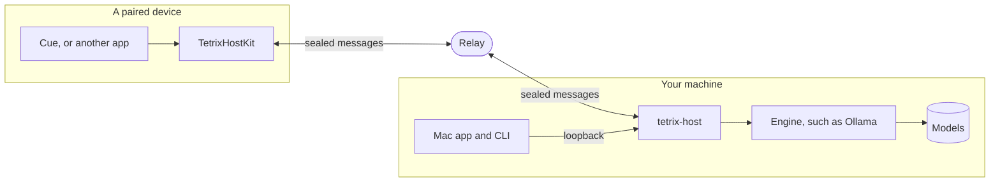

# How Tetrix Host works

Tetrix apps send some of their work to language models. By default that work goes to models Tetrix rents. Tetrix Host lets a person send it to a machine they own instead: a Mac mini on a shelf, a workstation with a graphics card, a server in a school's comms room. This page explains the parts and why they are shaped the way they are.

## The parts

**The host** is one program, `tetrix-host`. It keeps the list of paired devices, holds a connection open to a relay, and passes each request it receives to a model.

**An engine** is the program that runs models. The host does not run models itself. It fronts engines that already do it well and that speak the OpenAI HTTP dialect: Ollama, llama.cpp's `llama-server`, LM Studio, vLLM, and others.

**The relay** is a small server on the public internet. The host dials out to it, and so does each app. The relay passes sealed messages between the two and holds no key that opens them.

**TetrixHostKit** is a Swift package an app adds. It pairs with a host, opens the sealed connection, and gives the app a way to send a request and read the answer as it streams.

**The Mac app and the CLI** are two views of the same host. Both talk to it over a loopback API. Anything you can do in one, you can do in the other.

## Why a relay, and not a direct connection

A machine at home sits behind a router that refuses connections from outside. The usual answers are a static address with a forwarded port, or a VPN such as Tailscale. Both work, and both ask the person to become a network administrator before they can use the product.

A relay removes that step. The host makes an outbound connection, which every router allows, and keeps it open. An app does the same. The relay joins the two. Nothing needs configuring, and it works from a phone on a train.

The cost is that a third machine now carries the traffic. The design pays that cost down to nearly nothing by sealing the traffic end to end, so the relay is a pipe and not a participant. [Security model](security.md) describes what the relay can and cannot learn. If the remaining exposure is too much, the relay is a single binary and anyone can [run one](../how-to/run-your-own-relay.md).

A direct path between an app and a host on the same network would be faster and would skip the relay. The protocol allows for it, because the sealed channel does not care what carries it. This version does not include it.

## Why pairing uses a code

The app and the host have never met, and the only channel between them runs through a relay that must not be trusted. Something has to cross from one to the other without touching the relay.

That something is the pairing code. The host shows it, as a QR image or a link, and the person carries it to the app by scanning or pasting. The code holds a random secret that both sides mix into the pairing handshake. A relay in the middle does not have the secret and cannot complete the handshake for either side.

Once paired, each side holds the other's public key. Later connections need no code and no account. There is no Tetrix sign-in anywhere in the path, and Tetrix holds no list of who is paired with what.

## Why apps ask for a role and not a model

Tetrix apps split their work in two. Work that needs thought goes to a larger model. Short work, such as a yes-or-no decision or a one-line rewrite, goes to a smaller, faster one. The split keeps an app quick without making it shallow.

A host keeps the same split and calls the two kinds of work **deep** and **quick**. An app asks for a role. The host's owner assigns a model to each role, and can change the assignment at any time without touching the app.

This matters because the right models depend on the machine. A 16 GB Mac mini cannot hold what a workstation with two graphics cards can. If apps named models, every app would need to know every machine. With roles, the app says what kind of work it has, and the person who knows the hardware decides what does it.

A host with one model, or an owner who prefers it, uses the same model for both roles. That is one setting, "One model for everything".

## Why the host does not run models itself

Running a model well is a large job: loading weights, using the graphics card, batching, quantization formats, new architectures every month. Projects such as Ollama and llama.cpp do this full time and do it on every platform.

The host's own job is narrow: pairing, the tunnel, roles, and a view of what is happening. Keeping the two apart means the host stays small enough to audit, and a person can use whichever engine suits their hardware. The price is one more thing to install. On a Mac that is Ollama, and the host finds it without being told.

## Why two languages

The host, the CLI, and the relay are written in Go. A host must run on whatever hardware a person has, which means macOS, Linux, and Windows, on Apple silicon and on PCs with graphics cards. Go builds one static binary for each from the same code, and its standard library covers everything the host does.

The client package and the Mac app are written in Swift, because the apps that use them are.

That leaves the protocol implemented twice. For a security protocol this is a feature as much as a cost. Two implementations cannot agree by accident, and the test suite makes them prove they agree byte for byte.

## What a request looks like, end to end

1. Cue needs a model to plan a task. It builds a chat request with `"model": "deep"` and hands it to TetrixHostKit.
2. TetrixHostKit seals the request and sends it to the relay over the connection it already has open.
3. The relay passes the sealed messages to the host. It sees their size and nothing else.
4. The host opens them, sees that the request came from a paired device, and looks up the model assigned to deep work.
5. The host sends the request to the engine on the same machine, with the role replaced by the model's name.
6. The engine streams its answer. The host seals each piece and sends it back the way the request came.
7. Cue reads the answer as it arrives.

If Cue cancels, the cancel travels the same path and the engine stops generating.
