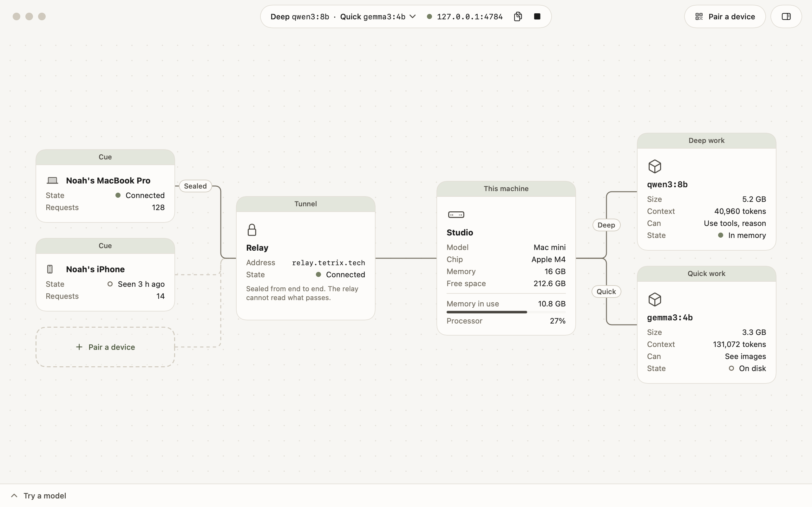

# How to use the Mac app

Tetrix Host for Mac is a window onto the host on the same machine. It shows the machine, its models, the tunnel, and the paired devices as cards on a board. Everything the app does, the [command line](../reference/cli.md) does too, and both show the same host.



## Build and open the app

You need Xcode 27, [XcodeGen](https://github.com/yonaskolb/XcodeGen), and Go 1.26 or later. The build puts a copy of `tetrix-host` inside the app.

```sh
make app
open ".build/xcode/Build/Products/Debug/Tetrix Host.app"
```

To work on the app in Xcode, run `xcodegen generate` and open `TetrixHost.xcodeproj`.

## Start and stop the host

If no host is running, the board shows this machine alone and says that Tetrix Host is stopped. Click **Start**.

The app runs the host as its own child process, and stops it when you quit the app. To keep a host running without the app, [run it in the background](run-in-the-background.md). The app then shows that host, and its Stop button is unavailable, because the app did not start it.

## Read the board

| Card | Shows |
|------|-------|
| This machine | The host's name, the hardware, and how much memory and processor are in use |
| Deep work, Quick work | The model assigned to each kind of work, its size, and what it can do |
| Tunnel | The relay and whether the host is connected to it |
| A device | A paired app on one device, and whether it is connected now |

A line joins two cards that can talk. A solid line is a live connection. A dashed line is one that is not live now. While a request runs, a dash moves along its path, from the device to the model that answers.

A card that needs attention says so in its header, for example "Tunnel · Offline".

Drag a card to move it. Drag the background to pan, and pinch to zoom. **View > Zoom to fit** brings everything back into view. **View > Tidy board** puts every card back in its place.

With the keyboard, press Tab to reach the board, the arrow keys to move between cards, and Return to open a card in the inspector.

## Change what the host does

Open the inspector with the button at the right of the toolbar. With no card selected, it shows the host.

- To rename the host, edit **Name**.
- To use another relay, edit **Relay**. Paired devices must then pair again.
- To assign models, choose under **Models**, or turn on **One model for everything**.
- To download a model, click **Download a model**.

Select a device card to rename the device or unpair it. Select a model card to assign it or delete it.

## Pair a device

Click **Pair a device** in the toolbar. [How to pair an app](pair-an-app.md) has the steps.

## Try a model

Open **Try a model** at the bottom of the window, choose **Deep** or **Quick**, and type. The request goes through the host the same way an app's request does, so the board shows it.

## Point the app at another data directory

The app reads `TETRIX_HOST_HOME`, as the command line does. Set it to look at a second host on the same machine.

```sh
open -n --env TETRIX_HOST_HOME="$HOME/second-host" ".build/xcode/Build/Products/Debug/Tetrix Host.app"
```
